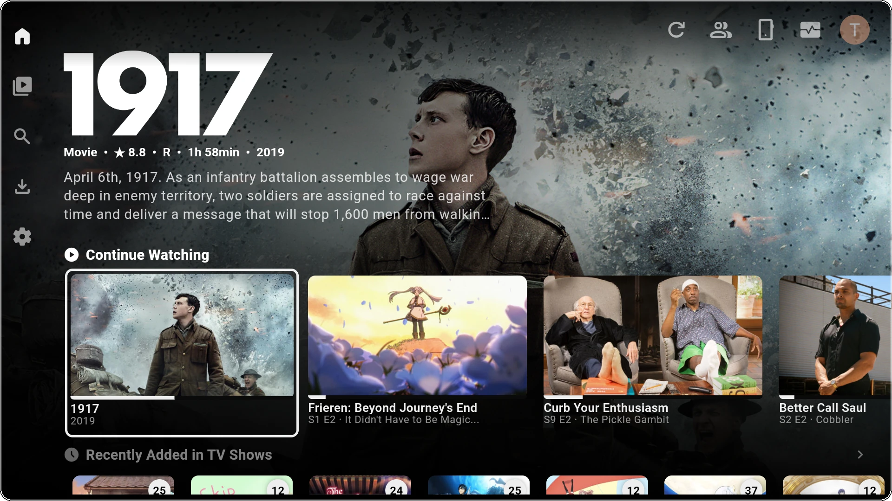
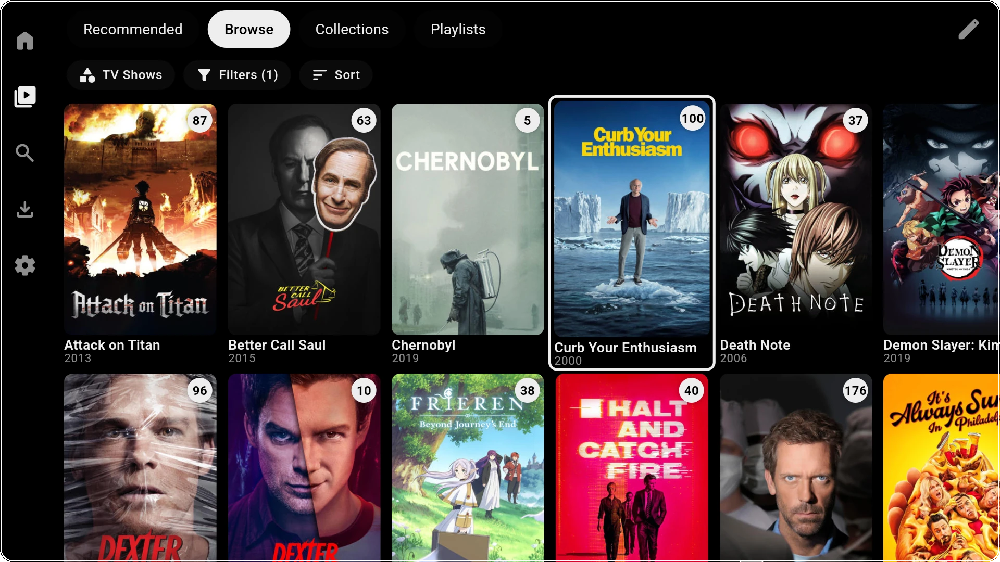
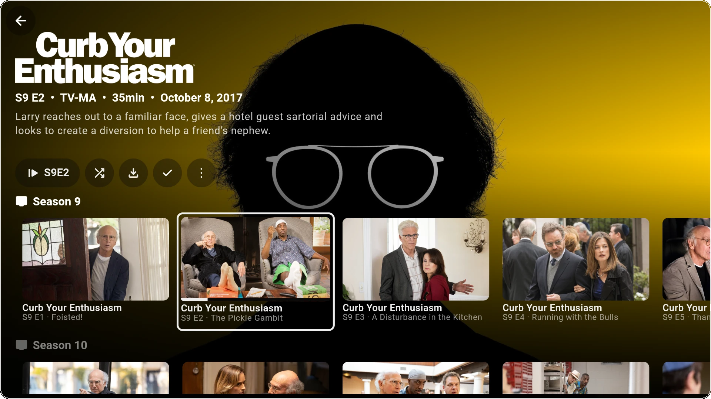

<h1>
  
  Plezy for LG webOS
</h1>

An unofficial LG webOS TV port of [Plezy](https://github.com/edde746/plezy), the Flutter-based media client for Plex, Jellyfin, and Emby.

This build runs natively on webOS using [`flutter-webos`](https://github.com/lg-flutter-webos/flutter-webos), pairs the Flutter UI with LG's hardware-decoded `NDL_media` pipeline, and includes a custom subtitle engine for ASS/SSA, SRT/VTT, and Blu-ray PGS streams.

> [!NOTE]
> This repository maintains the community webOS TV port (`com.mcphailmonator.plezy`). For official desktop and mobile releases or general app documentation, visit [`edde746/plezy`](https://github.com/edde746/plezy).

<p>
  <a href="#choosing-an-ipk">Choosing an IPK</a> ·
  <a href="#installation">Installation</a> ·
  <a href="#webos-highlights">webOS Highlights</a> ·
  <a href="#building-from-source">Building from Source</a> ·
  <a href="BUILD_WEBOS.md">Toolchain Guide</a> ·
  <a href="WEBOS_COMPAT_PATCHING.md">Compatibility Notes</a> ·
  <a href="LICENSE">License</a>
</p>

<p align="center">
  
  
</p>
<p align="center">
  
  
</p>

## Choosing an IPK

Each release provides two 32-bit ARM (`armv7l`) `.ipk` files on the [Releases page](https://github.com/mcphailmonator-star/plezy-webos/releases/latest). Because both packages use the app ID `com.mcphailmonator.plezy`, only one variant (and one Homebrew repository) should be installed on a TV at a time.

Pick the package that matches the **year your TV hardware was released**, not just the webOS number shown in settings. Models from 2022–2024 that upgrade to webOS 25 or 26 via LG's *webOS Re:New* program keep their original `glibc 2.31–2.35` userland and `wl_webos_shell` v1 Wayland protocol, so they still need the `webos6-24` build.

| TV Hardware Generation | Package File | Homebrew Channel / Glasshouse `.repo.json` | Target Runtime |
| --- | --- | --- | --- |
| **2025–2026 Models** (shipped with webOS 25 or 26) | [`com.mcphailmonator.plezy_*_arm_webos25-26.ipk`](https://github.com/mcphailmonator-star/plezy-webos/releases/latest) | `https://raw.githubusercontent.com/mcphailmonator-star/plezy-webos/hb-repo/plezy-webos25-26.repo.json` | Native `glibc 2.38+`, `wl_webos_shell` v2, `NDL_MediaInitWithWindowId` |
| **2021–2024 Models** (webOS 6.x–24, plus *Re:New* 25/26 updates) | [`com.mcphailmonator.plezy_*_arm_webos6-24.ipk`](https://github.com/mcphailmonator-star/plezy-webos/releases/latest) | `https://raw.githubusercontent.com/mcphailmonator-star/plezy-webos/hb-repo/plezy-webos6-24.repo.json` | Bundles `libwebos_compat32.so` (`glibc 2.28+` & Wayland v1 shims), `libstdc++.so.6` (`6.0.32`), and `libsqlite3_dart.so` (`3.50.2`) |

> [!TIP]
> If the `webos25-26` package exits right after opening, remove it and install the `webos6-24` package instead. If you run into playback issues on older firmware, runtime logs are written to `/media/developer/temp/plezy_appdata/log`.

## Installation

### 1. Homebrew Channel or Glasshouse (Recommended)

Installing through [webOS Homebrew Channel](https://github.com/webosbrew/webos-homebrew-channel) or Glasshouse enables automatic updates:

1. Open **Homebrew Channel** on the TV and navigate to **Settings → Repositories**.
2. Select **Add Repository** and paste the single `.repo.json` URL for your TV from the table above. Make sure to use the raw `.repo.json` link rather than the GitHub repo URL or a `.manifest.json` link, and avoid adding both repositories simultaneously.
3. Go back to the main catalog, select **Plezy (webOS 6-24)** or **Plezy (webOS 25-26)**, and press **Install**.
   - *Note:* If an older TV reports `-5: ipk verified failed`, check **Settings → General → System → Time & Timer** and confirm the system clock is set accurately.

### 2. webOS Dev Manager (No Root Needed)

1. Download the appropriate `.ipk` from the [Latest Release](https://github.com/mcphailmonator-star/plezy-webos/releases/latest).
2. Install the **Developer Mode** app from the LG Content Store on your TV, sign in with an LG Developer account, and turn on **Dev Mode Status** and **Key Server**.
3. Launch [webOS Dev Manager](https://github.com/webosbrew/dev-manager-desktop/releases) on your computer and connect to the TV with its IP address and Developer Mode passphrase.
4. Click **Install** (`+`), pick the downloaded `.ipk`, and open **Plezy** from the TV launcher.

> [!IMPORTANT]
> Unrooted TVs using LG Developer Mode require the developer session timer to be renewed before it expires, otherwise webOS removes sideloaded apps automatically.

### 3. Command Line (`ares-install`)

With Node.js 20+ and `@webos-tools/cli` installed:

```bash
npm install -g @webos-tools/cli

# Register your TV once (IP address, port 9922, user prisoner, Developer Mode passphrase)
ares-setup-device

# Install the IPK for your hardware
ares-install -d <tv-name> com.mcphailmonator.plezy_*_arm_webos6-24.ipk

# Launch the app
ares-launch -d <tv-name> com.mcphailmonator.plezy
```

## webOS Highlights

On top of the core [Plezy feature set](https://github.com/edde746/plezy#features) (multi-server Plex/Jellyfin/Emby support, Discover & Seerr requests, Watch Together, Live TV, and external tracker sync), this port includes webOS-specific work:

- **Hardware Media Pipeline (`NDL_media`):** Direct play and transcode streaming through LG's native media pipeline with multi-audio track switching, aspect ratio / fit mode controls, and video zoom.
- **Magic Remote & D-Pad Input:** Full directional pad navigation plus Magic Remote pointer support across multi-seat Wayland compositors and scroll-wheel handling.
- **Custom Subtitle Renderer:** 60fps rendering for styled ASS/SSA, SRT/VTT, and bitmap Blu-ray PGS subtitles, including live subtitle demuxing from streaming MKV containers.
- **TV Performance Tuning:** Native 1920×1080 surface rendering, capped Skia GPU cache (64 MB), deferred image decoding during fast scroll, reduced visual-effects tier for TV hardware, adaptive playback position polling, and batched async file logging.
- **Broad Firmware Compatibility:** Dual packaging covers both modern `glibc 2.38` firmware (webOS 25/26) and legacy `glibc 2.28–2.35` firmware (webOS 6.x–24 and *Re:New* upgrades) via `libwebos_compat32.so`.

## Building from Source

All required webOS plugins (`webos_plugins/`) and Dart 3.10-patched dependencies (`vendor/`) are checked directly into this repository. For detailed toolchain specs, see [`BUILD_WEBOS.md`](BUILD_WEBOS.md), [`WEBOS_COMPAT_PATCHING.md`](WEBOS_COMPAT_PATCHING.md), and [`WEBOS_CI.md`](WEBOS_CI.md).

### Automated Setup & Build (Linux x86_64)

```bash
git clone -b webos-main https://github.com/mcphailmonator-star/plezy-webos.git
cd plezy-webos

# Install Starfish NDK 11.2.0, flutter-webos (Flutter 3.38.10 / Dart 3.10.9), Node.js 22, and ares 3.2.6
./scripts/webos/ci/setup-toolchain.sh

# Build both IPK variants into ./dist/
./scripts/webos/ci/build.sh
```

### Manual Build Steps

```bash
source scripts/webos/env.sh
flutter-webos pub get
flutter-webos build webos --release
./scripts/webos/build_32bit_ipk.sh
```

Generated packages are placed in `dist/`:
- `dist/com.mcphailmonator.plezy_<version>_arm_webos25-26.ipk`
- `dist/com.mcphailmonator.plezy_<version>_arm_webos6-24.ipk`

## License & Credits

- Licensed under [GPL-3.0](LICENSE) (see [TRADEMARKS.md](TRADEMARKS.md) for upstream name and logo policy).
- Upstream application by [`edde746/plezy`](https://github.com/edde746/plezy).
- Built with [`lg-flutter-webos/flutter-webos`](https://github.com/lg-flutter-webos/flutter-webos).
